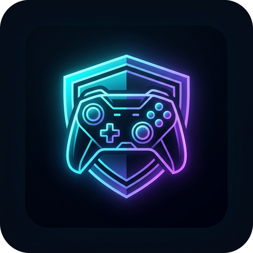

<div align="center">

  

  # 🎮 GameVault

  **The Ultimate Lightweight Desktop Command Center & Alt-Account Manager for Gamers.**

  [](https://github.com/ArtoMoon/GameVault/releases/latest)
  [](https://tauri.app/)
  [](https://www.rust-lang.org/)
  [](https://nextjs.org/)
  [](https://www.sqlite.org/)
  [](https://www.mongodb.com/)
  [](https://tailwindcss.com/)

  <p align="center">
    Track, categorize, and manage your gaming accounts from a unified single-screen vault with live API stats, zero-setup local SQLite storage, and dynamic platform presets across <b>Riot Games</b>, <b>Albion Online</b>, <b>Steam</b>, <b>Epic Games</b>, and custom gaming platforms.
  </p>

  <p align="center">
    <a href="https://github.com/ArtoMoon/GameVault/releases/latest"><b>📥 Download GameVault v0.4.2 Setup (.exe)</b></a> •
    <a href="#-whats-new-in-v042">What's New in v0.4.2</a> •
    <a href="#-key-features">Key Features</a> •
    <a href="#-getting-started-development">Development</a>
  </p>

</div>

---

## 🚀 What's New in v0.4.2

* **⚡ Zero-Setup Embedded SQLite Engine (WAL Mode):** GameVault now uses Node's built-in `node:sqlite` (`%APPDATA%\GameVault\gamevault.sqlite`) by default—no external database installation required!
* **🔄 Optional MongoDB & 1-Click Migration:** Prefer MongoDB or MongoDB Atlas? Toggle between **Local SQLite** and **MongoDB** anytime from Settings, or migrate all existing MongoDB records into local SQLite with a single click.
* **🏷️ Unified Single-Screen Platform Vault + Inline Categories:** Clicking a platform opens directly into a unified accounts dashboard with an always-visible **Category Bar** and inline **`+ Kategori Ekle`** creator—no intermediate sub-game screens.
* **⬆️ 1-Click In-App Auto-Updater:** Automatically checks GitHub Releases on launch and downloads & launches the new Windows Setup `.exe` directly from the sidebar with 1 click.
* **📥 System Tray & Background Mode:** Enable *"Minimize to System Tray on Close"* in Settings to keep GameVault running quietly in the Windows notification area.
* **🔒 Dedicated Dynamic Port (`47310+`) & Health Signature Verification:** Never conflicts with local development servers on port `3000`.
* **✨ Glassmorphic Dark UI v2:** Redesigned with collapsible sidebar navigation, ambient glow cards, segmented controls, and high-density account views.

---

## ⚡ Why GameVault? (Tauri v2 Architecture)

GameVault is built on a modern, ultra-optimized **Tauri v2 + Rust + Embedded SQLite** desktop engine:

| Benchmark | Traditional Clients (Electron) | 🎮 **GameVault (Tauri v2)** |
|---|---|---|
| **Setup File Size** | ⚠️ ~185 MB | ⚡ **~35 MB (80% smaller!)** |
| **Database Requirement** | ❌ External DB / Heavy Service | ✅ **Zero-Setup Embedded SQLite (WAL)** |
| **Installation Speed** | ⏳ 1–2 minutes | 🚀 **Under 3 seconds** |
| **Idle Memory (RAM)** | ❌ 250 MB – 400 MB | 🛡️ **~45 MB – 65 MB** |
| **Gaming Performance** | Can cause micro-stutters / FPS drops | **Zero impact on in-game FPS** |

---

## 🌟 Key Features

### 🗄️ 1. Hybrid Database Engine (Embedded SQLite + Optional MongoDB)
* **Instant Local SQLite Storage:** Runs out-of-the-box with `node:sqlite` in `WAL` (Write-Ahead Logging) mode stored safely in `%APPDATA%\GameVault\gamevault.sqlite`.
* **1-Click MongoDB to SQLite Migration:** Automatically detects and imports accounts, platforms, categories, and settings from local MongoDB databases (`test`, `mylol`, `gamevault`).
* **Optional MongoDB Mode:** Connect to a local MongoDB instance or remote MongoDB Atlas cluster whenever you want cloud/network sync.

### 🏷️ 2. Unified Platform Dashboard & Inline Category System
* **Single-Screen Platform View:** Entering any platform (e.g., **Riot Games**, **Albion Online**, **Steam**) takes you straight to all accounts in that platform without extra intermediate screens.
* **Inline Category Creator (`+ Kategori Ekle`):** Create custom categories with custom icons (`⭐`, `⚡`, `🏆`, `🎯`, `🔥`, `💎`) and accent colors directly from the category bar, or manage them in bulk.
* **Multi-View Account Table:** Switch seamlessly between **Grid Cards**, **Compact Grid**, **Horizontal List**, and **Minimal Table** views.

### 🔴 3. Riot Games & League of Legends Live Tracking
* **Riot ID Integration:** Synchronize summoners using `GameName#TAG`.
* **Live Competitive Metrics:** Solo/Duo & Flex ranks, LP, win rates, and match history analytics.
* **Multi-Region Support:** TR, EUW, EUNE, NA, KR, and all official Riot server clusters with automatic rate-limit safety.

### 🛡️ 4. Albion Online Live API Synchronization
* **API Key-Free Lookup:** Instant character verification via Albion Online's official public gameinfo & killboard APIs across **Europe**, **Americas**, and **Asia** servers.
* **Live Combat & Fame Metrics:** Synchronizes **Total Lifetime Fame**, **PvP Kill Fame**, **PvE Fame**, **Guild**, **Alliance**, and character avatars.

### 🖥️ 5. Native Desktop Experience
* **System Tray Integration:** Left-click the tray icon to restore the window immediately, or use the right-click native tray menu (*GameVault'u Aç* / *Tamamen Çıkış Yap*).
* **1-Click Update Installer:** Notifies you when a new release is published on GitHub and installs it automatically.
* **Dual-Language Support (TR / EN):** Instant toggle between Turkish (🇹🇷) and English (🇬🇧).

---

## 📥 Download Windows Installer (.exe)

Get the latest **GameVault Windows Setup** directly from GitHub Releases:

👉 **[Download GameVault v0.4.2 Windows Setup (.exe)](https://github.com/ArtoMoon/GameVault/releases/latest)**

*(Includes embedded local SQLite database, desktop shortcut, system tray support, and Windows uninstaller).*

---

## 🛠️ Getting Started (Development)

### Prerequisites
* [Node.js](https://nodejs.org/) (v22.5+ recommended for built-in `node:sqlite`)
* [Yarn](https://yarnpkg.com/)
* [Rust & Cargo](https://rustup.rs/) (MSVC toolchain: `rustup default stable-x86_64-pc-windows-msvc`)
* [Visual Studio C++ Build Tools](https://visualstudio.microsoft.com/visual-cpp-build-tools/) (`Desktop development with C++`)

### 1. Clone the Repository
```bash
git clone https://github.com/ArtoMoon/GameVault.git
cd GameVault
```

### 2. Install Dependencies
```bash
yarn install
```

### 3. Run Desktop Development Mode (Tauri)
```bash
yarn tauri:dev
```
*(No `.env.local` or MongoDB setup required—GameVault automatically initializes its local SQLite database on first launch).*

### 4. Build Windows Setup (.exe) & Publish Release
```bash
# Build installer only
yarn tauri:build

# Build installer and publish to GitHub Releases
yarn release:all
```
The optimized NSIS setup installer will be generated at:
```text
src-tauri/target/release/bundle/nsis/GameVault_0.4.2_x64-setup.exe
```

---

## 📁 Repository Structure

```text
├── app/
│   ├── accounts/[id]/          # Detailed account analytics & match history
│   ├── actions/                # Next.js Server Actions (accounts, platforms, categories, settings)
│   ├── api/                    # API Route Handlers (/api/health, /api/update-check, /api/sync-accounts)
│   ├── platform/[platform]/    # Unified single-screen Platform & Category Accounts Vault
│   ├── globals.css             # Glassmorphic Dark Design System v2 tokens & utilities
│   ├── layout.tsx              # Root layout with collapsible Sidebar & Providers
│   └── page.tsx                # Landing Dashboard with live stats & platform cards
├── components/                 # Reusable UI Components
│   ├── Sidebar.tsx             # Collapsible app sidebar, 1-click updater & language toggle
│   ├── GameAccountsView.tsx    # Unified platform accounts dashboard + inline category creator
│   ├── AccountTable.tsx        # Multi-mode account browser (Grid, Compact, List, Table)
│   ├── AccountCard.tsx         # Account card with live sync & status actions
│   ├── OnboardingModal.tsx     # Settings modal (SQLite/MongoDB engine, System Tray, API Keys)
│   ├── CategoryManagerModal.tsx# Category creation & management modal
│   └── PlatformManagerModal.tsx# Platform presets, custom ordering & editor
├── frontend-dist/              # Splash loader with Tauri server discovery
├── lib/
│   ├── db/
│   │   ├── sqlite.ts           # Embedded node:sqlite WAL database engine
│   │   ├── hybridModel.ts      # Mongoose-compatible hybrid model proxy (SQLite + MongoDB)
│   │   └── mongoose.ts         # Engine switcher & 1-click MongoDB->SQLite migrator
│   ├── desktop.ts              # Tauri v2 client commands (System Tray, Auto-Updater)
│   ├── i18n/                   # Language Context & Dictionary (TR / EN)
│   └── riot/                   # Riot Games API client
├── models/                     # Data Models (Account, Platform, Category, Setting)
├── scripts/
│   ├── migrate-mongo-to-sqlite.cjs # CLI utility to migrate local MongoDB data to SQLite
│   ├── prepare-standalone.cjs  # Next.js standalone dereferencing & bundling
│   ├── prepare-tauri.cjs       # Node.js runtime preparation for Tauri sidecar
│   └── publish-release.mjs     # Automated GitHub Release uploader
└── src-tauri/                  # Tauri v2 native Rust backend, System Tray & Updater
```

---

## ⚖️ Legal Disclaimer

*GameVault is an independent third-party tool and is not affiliated with, endorsed by, or sponsored by Riot Games, Sandbox Interactive (Albion Online), Valve (Steam), Epic Games, Blizzard Entertainment, or any other game publisher. All trademarks and registered trademarks belong to their respective owners.*

---

## 📝 License

This project is licensed under the [MIT License](LICENSE).
